# bedrock-multi-model-mcp

[](https://github.com/Sagargupta16/bedrock-multi-model-mcp/stargazers)
[](https://github.com/Sagargupta16/bedrock-multi-model-mcp/network/members)
[](LICENSE)
[](https://github.com/Sagargupta16/bedrock-multi-model-mcp/commits/main)
[](https://github.com/Sagargupta16/bedrock-multi-model-mcp/actions/workflows/ci.yml)

MCP server for AWS Bedrock - text, image, video and embeddings from any model. Use Claude, GPT, Grok, Kimi, Gemma, Mistral, Nova, Qwen, DeepSeek, and more from Claude Code (or any MCP client).

**Why:** Bedrock already gives one AWS account access to models from eleven text providers,
but each one is a different model ID, inference profile, region and request shape. This
server puts them behind nine MCP tools and one set of AWS credentials, so an agent can
ask a second model for a review, run the same prompt across five models side by side, have
a judge model score those answers blind, or generate and edit an image, without leaving
the chat or writing SDK code.

At a glance: 33 text models from 11 providers, 3 image models, 13 image-editing services,
1 video model and 3 embedding models, all defined as data in [src/data/](src/data/) and
validated at startup.
The 26 text models in the 2026-10-18 [benchmark](#benchmark) answered every call. Since
that run, Claude Opus 5.5, Sonnet 5.5 and Haiku 5.5 and, in 0.7.0, twelve models from
OpenAI, xAI, Moonshot AI, Google, MiniMax, NVIDIA, Mistral and Qwen joined the registry, while the
five models AWS moved to Legacy on 2026-09-30 (Llama 4 Maverick and Scout, Llama 3.3 70B,
Devstral 2, DeepSeek R1) left it.

<picture>
  <source media="(prefers-color-scheme: dark)" srcset="docs/demo/judge-dark.svg">
  <source media="(prefers-color-scheme: light)" srcset="docs/demo/judge-light.svg">
  
</picture>

A real `bedrock_judge` run from 2026-10-18, called through
[`scripts/call-tool.mjs`](scripts/call-tool.mjs) with the arguments in
[docs/demo/judge-args.json](docs/demo/judge-args.json). The output lines are excerpted from
that run with the table columns aligned; the full reply also carries the judge's reasoning
and all three answers. Llama 4 Maverick has since gone Legacy on Bedrock and left the
registry, so swap `llama4` for another model to rerun it.

## Tools

| Tool | Description |
|------|-------------|
| `bedrock_ask` | Send a prompt to any text model. Returns response with token counts and latency. `schema` returns JSON that matches a JSON schema; `effort` sets the thinking depth. |
| `bedrock_compare` | Same prompt to 2-5 models side by side. Compare quality, speed, and style. Takes `schema` and `effort` too. |
| `bedrock_judge` | Same prompt to 2-5 models, then a judge model scores the answers blind and picks a winner, optionally merging them into one answer. The verdict comes back as schema-checked JSON when the judge supports it. |
| `bedrock_list_models` | List available text models with aliases, use cases, and capabilities. |
| `bedrock_generate_image` | Generate images from text (Stable Image Ultra, SD3.5 Large, Stable Image Core). Saves PNG locally. |
| `bedrock_edit_image` | Edit or transform a local image with the 13 Stability AI Image Services: inpaint, outpaint, erase, remove the background, find and replace or recolor an object, three upscalers, sketch and structure control, style guide and style transfer. Saves PNG locally. |
| `bedrock_generate_video` | Start async video generation (Luma Ray 2). Output to S3. |
| `bedrock_video_status` | Check video generation job progress. |
| `bedrock_embed_similarity` | Embed 2+ texts (Titan, Cohere) and return a cosine-similarity matrix. |

## Supported Models

Model data lives in [src/data/](src/data/) (`text-models.json`, `image-models.json`, `image-edit-models.json`, `video-models.json`, `embedding-models.json`) - edit those files to add or remove models without touching code.

### Text (Converse API, and bedrock-mantle for Gemma 4)

| Provider | Models | Aliases |
|----------|--------|---------|
| Anthropic | Claude Fable 5.1, Opus 5.5, Sonnet 5.5, Haiku 5.5 (current); Fable 5, Opus 5 / 4.6, Sonnet 5 / 4.6, Haiku 4.5 (previous-gen) | `fable`, `claude-opus`, `claude-sonnet`, `claude-haiku` |
| OpenAI | GPT-6.1 Sol, GPT-6.1 Terra, GPT-OSS 120B, GPT-OSS 20B | `gpt-sol`, `gpt-terra`, `gpt-oss`, `gpt-oss-20b` |
| xAI | Grok 4.7 | `grok` |
| Moonshot AI | Kimi K3 | `kimi` |
| Mistral | Mistral Large 3, Ministral 3 14B, Magistral Small, Pixtral Large | `mistral-large`, `ministral`, `magistral`, `pixtral` |
| Amazon | Nova Pro, Nova 2 Lite, Nova Lite, Nova Micro | `nova-pro`, `nova2-lite`, `nova-lite`, `nova-micro` |
| Qwen | Qwen3 Coder Next, Qwen3 VL 235B, Qwen3 Next 80B A3B | `qwen-coder`, `qwen-vl`, `qwen-next` |
| DeepSeek | DeepSeek V3.2 | `deepseek` |
| Google | Gemma 4 31B, Gemma 4 26B A4B, Gemma 4 E2B (bedrock-mantle) | `gemma`, `gemma-4-26b`, `gemma-4-e2b` |
| MiniMax | MiniMax M2.5 | `minimax` |
| NVIDIA | Nemotron 3 Super 120B | `nemotron` |

Gemma 4 is served only on Bedrock's OpenAI-compatible `bedrock-mantle` endpoint, not
through Converse, so those entries carry `"api": "mantle"` and the server calls their
Chat Completions API (`https://bedrock-mantle.<region>.api.aws/openai/v1`) instead. Every
tool works with them, side by side with Converse models in `bedrock_compare` and
`bedrock_judge`. They need `AWS_BEARER_TOKEN_BEDROCK`: AWS also accepts SigV4 on that
endpoint, but this server does not sign mantle requests.

Listed on Bedrock but not in the registry: GLM 5.3 and Claude Mythos 5.1 (access is gated
per account; both failed the 2026-11-01 probe), and Grok 4.3 (answers on bedrock-mantle,
but Grok 4.7 supersedes it). AWS lists no Active Meta model.

Bare-tier aliases (`fable`, `claude-opus`, `claude-sonnet`, `claude-haiku`, `gpt-sol`,
`gpt-terra`) track the current model in that tier; version-pinned aliases (`fable-5`,
`claude-opus-5`, `claude-sonnet-5`, `claude-haiku-4.5`, `claude-opus-4.6`,
`claude-sonnet-4.6`) keep the previous generations reachable. AWS announced Claude Opus 5.5 on Bedrock on 2026-09-22,
Sonnet 5.5 on 2026-09-28 and Haiku 5.5 on 2026-10-07, so the bare `claude-opus`,
`claude-sonnet` and `claude-haiku` now resolve to the 5.5 models.

`temperature` is the one thing that differs across those entries. Anthropic deprecated
`temperature` / `top_p` / `top_k` for Claude Opus 4.7 and later, where a non-default
value returns a 400, so `text-models.json` marks those entries `noTemperature` and this
server omits the parameter for them - the `temperature` argument is accepted but has no
effect. The three 5.5 models return the same 400 (probed 2026-10-21), and so do GPT-6.1
Sol and Terra, Grok 4.7 and Kimi K3 ("This model doesn't support the temperature field",
probed 2026-11-01). Gemma 4 and the other open-weight models take it. Claude Haiku 4.5,
Opus 4.6 and Sonnet 4.6 still honor it, so pin
`claude-sonnet-4.6` or `claude-haiku-4.5` if you need to set it on a Claude model.

The `maxTokens` value in `text-models.json` is the default output cap **this server**
sends when a call omits `max_tokens` - deliberately below the model's own ceiling
(Anthropic documents 128K max output for Fable 5.1 and the 5.5 and 5 models, 64K for
Haiku 4.5). Pass `max_tokens` to go higher on a single call.

#### Structured output and effort

`schema` on `bedrock_ask` and `bedrock_compare` sends a JSON schema as Converse
`outputConfig.textFormat`, so the reply is JSON that matches it, shown pretty-printed.
Object schemas need `"additionalProperties": false`; Bedrock rejects numeric and string
length constraints (`minimum`, `maxLength` and the like) with a 400. Probed on every
registry model (2026-10-21, and 2026-11-01 for the models added then): all 10 Claude
models, GPT-6.1 Sol and Terra, both GPT-OSS models, Grok 4.7, Kimi K3, Mistral Large 3,
Ministral 3, all three Qwen3 models, DeepSeek V3.2, MiniMax M2.5, Nemotron 3 Super and the
three Gemma 4 models accept it (`structured_output` in `bedrock_list_models`; for Gemma it
is sent as Chat Completions `response_format`). Nova and Pixtral answer "This
model doesn't support the outputConfig field", and Magistral Small accepts the field but
ignores the schema, so this server refuses the call before it is billed. GPT-OSS puts a
stray character before its JSON (`B{...}`); the reply parser skips anything before the
first brace.

`effort` (`low`, `medium`, `high`, `xhigh`, `max`) sets the thinking depth and token
spend through Converse `outputConfig.effort`. Every Claude model except Haiku 4.5 takes
it, and so do GPT-6.1 Sol and Terra, Grok 4.7 and Kimi K3 (probed 2026-11-01). Gemma 4
takes `low` to `xhigh` as Chat Completions `reasoning_effort` and answers `max` with a
400 ("not supported with this model"). Claude
Opus 5.5 and Haiku 5.5 default to `medium`, the other Claude models to `high`. On
2026-10-21, "How many primes are below 100?" cost Haiku 5.5 3 output tokens at `low`
and 60 at `max`, with the same answer. `bedrock_ask` rejects `effort` for a model that
does not take it; `bedrock_compare` and `bedrock_judge` apply it only to the candidates
that do, so one value can tune the Claude answers in a mixed list.

### Image (InvokeModel API)

| Model | Alias | Region |
|-------|-------|--------|
| Stable Image Ultra (default) | `stable-ultra` | us-west-2 |
| Stable Diffusion 3.5 Large | `sd3.5` | us-west-2 |
| Stable Image Core | `stable-core` | us-west-2 |

Stability models take an **aspect ratio**, not pixel dimensions. The `width` and
`height` arguments only select the closest supported ratio (`1:1`, `16:9`, `9:16`,
`3:2`, `2:3`, `4:5`, `5:4`, `21:9`, `9:21`); the model picks the output pixels. The
size reported by `bedrock_generate_image` is read back out of the saved PNG, so it
is the real output size rather than what you asked for.

### Image editing (InvokeModel API)

`bedrock_edit_image` takes a local PNG, JPEG or WebP (`image_path`) and an `operation`.
Each operation is one of Stability AI's image services, called through its US inference
profile (`us.stability.*`) from us-west-2.

| Operation | Service | Needs besides the image | Also takes |
|-----------|---------|-------------------------|------------|
| `inpaint` | Stable Image Inpaint | `prompt` | `mask_path`, `grow_mask` |
| `outpaint` | Stable Image Outpaint | one of `left`, `right`, `up`, `down` (pixels) | `prompt`, `creativity` |
| `erase` | Stable Image Erase Object | - | `mask_path`, `grow_mask` |
| `remove-background` | Stable Image Remove Background | - | - |
| `search-replace` | Stable Image Search and Replace | `prompt`, `search_prompt` | `grow_mask` |
| `search-recolor` | Stable Image Search and Recolor | `prompt`, `select_prompt` | `grow_mask` |
| `upscale-fast` | Stable Image Fast Upscale | - | - |
| `upscale-conservative` | Stable Image Conservative Upscale | `prompt` | `creativity` |
| `upscale-creative` | Stable Image Creative Upscale | `prompt` | `creativity` |
| `control-sketch` | Stable Image Control Sketch | `prompt` | `control_strength` |
| `control-structure` | Stable Image Control Structure | `prompt` | `control_strength` |
| `style-guide` | Stable Image Style Guide | `prompt` | `fidelity`, `aspect_ratio` |
| `style-transfer` | Stable Image Style Transfer | `style_image_path` | `prompt`, `composition_fidelity`, `style_strength`, `change_strength` |

Most also take `negative_prompt`, `seed` and `style_preset`. A field the operation does
not take, or a missing required one, is refused before the call is billed. Without
`mask_path`, `inpaint` and `erase` use the input image's alpha channel as the mask. Only
PNG, JPEG and WebP files are read and sent, so a mistyped path never ships some other
local file to Bedrock. Each call is billed per image; Conservative and Creative Upscale
cost several times more than the other services
([AWS Bedrock pricing](https://aws.amazon.com/bedrock/pricing/)).

### Video (Async API)

| Model | Alias | Duration | Resolution | Region |
|-------|-------|----------|------------|--------|
| Luma Ray 2 | `luma-ray`, `ray2` | 5s or 9s | 720p | us-west-2 |

The output S3 bucket must be in us-west-2 (same region as the model).

Amazon Nova Canvas/Reel and Titan Image were removed when AWS marked them
end-of-life (Nova Canvas and Nova Reel EOL 2026-09-30). The registry only ships ACTIVE
models: AWS blocks new customers from Legacy ones. `npm run lifecycle` checks every
registry id against AWS's public lifecycle page (no credentials needed), and CI runs it
weekly and on every registry change.

### Embeddings (InvokeModel API)

| Model | Alias | Dimensions |
|-------|-------|------------|
| Amazon Titan Text Embeddings V2 | `titan-v2` | 1024 |
| Amazon Titan Multimodal Embeddings | `titan-multimodal` | 1024 |
| Cohere Embed v4 | `cohere` | 1536 |

`bedrock_embed_similarity` only sends text, so Titan Multimodal is exercised through
its text path here and behaves like `titan-v2` at the same 1024 dimensions. The Cohere
Embed v3 aliases (`cohere-en`, `cohere-multi`) now resolve to Embed v4, which covers
English and multilingual text. Titan embeds one text per request, so this server sends
8 at a time.

You can also pass any valid Bedrock model ID directly. Note: many foundation models require a cross-region inference profile (`us.` prefix) for on-demand invocation - the registry uses the working form for each model.

> **Model availability varies by region and account.** The registry IDs are verified working in `us-east-1`, but individual models may not be enabled in your region or granted to your account. Models you can't access return a clear error (per-model in `bedrock_compare`); the rest still work. Enable models in the AWS Console under Bedrock > Model access.

## Setup

### Prerequisites

- Node.js >= 22 (Node 20 reached end of life on 2026-04-30; CI runs 22, 24 and 26)
- AWS credentials configured (bearer token, env vars, `~/.aws/credentials`, SSO, or IAM role)
- Bedrock model access enabled in your AWS account (request access in the AWS Console under Bedrock > Model access)

### Install

The server is published on npm as
[`bedrock-multi-model-mcp`](https://www.npmjs.com/package/bedrock-multi-model-mcp) and listed
on the [MCP Registry](https://registry.modelcontextprotocol.io/) as
`io.github.Sagargupta16/bedrock-multi-model-mcp`, so an MCP client can start it with `npx`
and nothing has to be cloned or built.

### Configure in Claude Code

One command:

```bash
claude mcp add --transport stdio --scope user bedrock \
  --env AWS_REGION=us-east-1 \
  --env AWS_BEARER_TOKEN_BEDROCK=ABSK... \
  -- npx -y bedrock-multi-model-mcp
```

Or add it by hand to your Claude Code MCP settings (`~/.claude.json`):

```json
{
  "mcpServers": {
    "bedrock": {
      "command": "npx",
      "args": ["-y", "bedrock-multi-model-mcp"],
      "env": {
        "AWS_BEARER_TOKEN_BEDROCK": "ABSK...",
        "AWS_REGION": "us-east-1"
      }
    }
  }
}
```

### Configure in Claude Desktop

Same server block, in `claude_desktop_config.json`:

- macOS: `~/Library/Application Support/Claude/claude_desktop_config.json`
- Windows: `%APPDATA%\Claude\claude_desktop_config.json`

```json
{
  "mcpServers": {
    "bedrock": {
      "command": "npx",
      "args": ["-y", "bedrock-multi-model-mcp"],
      "env": {
        "AWS_BEARER_TOKEN_BEDROCK": "ABSK...",
        "AWS_REGION": "us-east-1",
        "BEDROCK_MCP_OUTPUT_DIR": "C:\\Users\\you\\bedrock-images"
      }
    }
  }
}
```

### Run from source

To change the server or pin it to a local build, clone and build it, then point the MCP
config at `node /path/to/bedrock-multi-model-mcp/dist/index.js` instead of `npx`:

```bash
git clone https://github.com/Sagargupta16/bedrock-multi-model-mcp.git
cd bedrock-multi-model-mcp
npm install
npm run build
```

Set `BEDROCK_MCP_OUTPUT_DIR` explicitly for Desktop: on Windows it spawns the server
from a write-protected directory (`C:\Windows\System32`), so the default "save next to
cwd" behavior cannot apply and generated images fall back to `~/bedrock-images/`.

### Environment Variables

| Variable | Default | Description |
|----------|---------|-------------|
| `AWS_REGION` | `us-east-1` | AWS region for Bedrock API calls |
| `AWS_DEFAULT_REGION` | - | Fallback region, used only when `AWS_REGION` is unset |
| `AWS_BEARER_TOKEN_BEDROCK` | - | Bedrock API Key bearer token (recommended) |
| `AWS_ACCESS_KEY_ID` | - | AWS access key (if not using bearer token/SSO) |
| `AWS_SECRET_ACCESS_KEY` | - | AWS secret key (if not using bearer token/SSO) |
| `AWS_PROFILE` | - | Named AWS profile from `~/.aws/credentials` |
| `BEDROCK_MCP_OUTPUT_DIR` | cwd (or `~/bedrock-images` if cwd is not writable) | Default output directory for generated images. Overridden by the `output_dir` tool arg. Directory is auto-created. |

### Authentication

The server supports two auth methods:

1. **Bedrock API Key (bearer token)** - Set `AWS_BEARER_TOKEN_BEDROCK`. The AWS SDK reads it and sends it as `Authorization: Bearer`, ahead of any IAM credentials. A set-but-empty value (for example an MCP config passing `"${AWS_BEARER_TOKEN_BEDROCK}"` from a client whose own environment lacks the variable) is ignored, so the IAM chain answers instead of every call failing with "the `token` is not defined".
2. **IAM credentials** - Standard AWS credential chain (env vars, profile, SSO, IAM role). Every model works this way except Gemma 4, whose `bedrock-mantle` endpoint this server reaches only with the bearer token.

## Usage Examples

### Ask a single model

```
"Use bedrock_ask to ask kimi to explain Docker in 3 sentences"
```

### Get JSON that matches a schema

```
"Use bedrock_ask with claude-haiku, effort low, and a schema with category, subcategory and amount_inr: Swiggy order, Mattar Paneer Meal, 203 rupees"
```

### Compare models

```
"Use bedrock_compare with kimi, nova-pro, and mistral-large: What are the pros and cons of microservices?"
```

`bedrock_compare` runs one full generation per model in the list, and each one is
billed independently - three models is three generations, five is five. This server
adds no markup and sets no rates; billing is entirely AWS Bedrock's, per model and
per token. Current rates: [AWS Bedrock pricing](https://aws.amazon.com/bedrock/pricing/)
and, for the Claude models, [Anthropic pricing](https://platform.claude.com/docs/en/about-claude/pricing).

### Let a judge pick the best answer

```
"Use bedrock_judge with kimi, nova-pro and deepseek: In two sentences, when should a team pick SQS over SNS?"
```

The candidates answer in parallel. The judge (default `claude-opus`, override with
`judge`) then sees the answers shuffled and labeled A, B, C with the model names
removed, scores each from 1 to 10, and names a winner. The tool maps the labels back
to models and returns a ranked table, the judge's reasoning, and every answer. When the
judge supports structured output (the default Opus 5.5 does), the verdict is requested
against a schema whose `winner` can only be one of the labels, so it always parses. Pass
`criteria` to change what is scored and `synthesize: true` to also get one merged
answer. A candidate that fails is listed under **Failed** and the rest are still
judged; if the judge call fails, the answers still come back. Billing is one
generation per candidate plus one for the judge.

### Generate an image

```
"Use bedrock_generate_image with stable-ultra: A futuristic Tokyo street at night, neon lights, rain"
```

### Edit an image

```
"Use bedrock_edit_image to remove the background from ./photo.png"
"Use bedrock_edit_image with search-replace on ./street.png: replace the car with a blue pickup truck"
```

### Generate a video

```
"Use bedrock_generate_video: Closeup of ocean waves crashing on rocks at sunset, s3_uri: s3://my-bucket/videos/"
```

### Compare text similarity

```
"Use bedrock_embed_similarity to compare: 'a cat', 'a kitten', 'a car'"
```

## Architecture

<picture>
  <source media="(prefers-color-scheme: dark)" srcset="docs/diagrams/architecture-dark.svg">
  <source media="(prefers-color-scheme: light)" srcset="docs/diagrams/architecture-light.svg">
  
</picture>

The spec behind the picture is [`docs/diagrams/architecture.yaml`](docs/diagrams/architecture.yaml), rendered with [orrery](https://github.com/Sagargupta16/orrery).

A tool call resolves its model alias against the registry, picks the request shape and
region from that entry, and sends it through a cached SDK client for that region. The
request carries the MCP call's abort signal, so when the client cancels a tool call (or
gives up on it), the server stops waiting on Bedrock: a Nova Micro call aborted at 400 ms
settled at 412 ms on 2026-11-01, against 6.4 s for the same call left to finish.
`bedrock_generate_video` is the exception, because cancelling a `StartAsyncInvoke` that
was already sent could leave a billed job running with no ARN to track it.

```
src/
  index.ts          # MCP server - tool registration, stdio transport
  judge.ts          # bedrock_judge - blind labels, judge prompt, verdict parsing
  models.ts         # Loads + validates registry data, resolves aliases
  types.ts          # Zod schemas for model data validation
  bedrock/
    client.ts       # Shared region/auth config, one cached SDK client per region
    converse.ts     # Converse API wrapper (text models), dispatches mantle models
    mantle.ts       # bedrock-mantle Chat Completions wrapper (Gemma 4)
    image.ts        # InvokeModel wrapper (image models)
    edit.ts         # InvokeModel wrapper (Stability image-edit services)
    video.ts        # Async invoke wrapper (video models)
    embed.ts        # InvokeModel wrapper (embeddings) + cosine similarity
  data/
    text-models.json       # Text model registry (data, not code)
    image-models.json      # Image model registry
    image-edit-models.json # Image-edit service registry (operation, required and optional fields)
    video-models.json      # Video model registry
    embedding-models.json  # Embedding model registry
scripts/
  call-tool.mjs     # Minimal stdio MCP client: list tools or call one
  benchmark.mjs     # Latency benchmark across every text model
  check-lifecycle.mjs # Fails if a registry model is Legacy or EOL on AWS's lifecycle page
```

Model definitions are data, kept in `src/data/*.json` and validated against Zod schemas at load time, so the catalog can be updated without changing logic. The build copies these JSON files into `dist/data/`.

- **Text**: Uses the [Converse API](https://docs.aws.amazon.com/bedrock/latest/APIReference/API_runtime_Converse.html) - unified interface across the text models, except Gemma 4, which uses bedrock-mantle Chat Completions
- **Image**: Uses [InvokeModel](https://docs.aws.amazon.com/bedrock/latest/APIReference/API_runtime_InvokeModel.html) with the Stability request format (prompt and aspect ratio)
- **Image editing**: Uses InvokeModel with the [Stability AI Image Services](https://docs.aws.amazon.com/bedrock/latest/userguide/stable-image-services.html) request format (base64 input image plus per-service fields)
- **Video**: Uses [StartAsyncInvoke](https://docs.aws.amazon.com/bedrock/latest/APIReference/API_runtime_StartAsyncInvoke.html) - requires S3 bucket for output

### Design decisions

| Decision | Why |
|----------|-----|
| Converse API for every text model on bedrock-runtime | One request and response shape across ten providers, so adding a text model is a JSON entry, not a new code path. |
| Gemma 4 through bedrock-mantle, behind the same options | Gemma 4 has no Converse API. Its requests are built by the same `buildConverseInput` (option checks, output cap, temperature rules) and only the transport changes, so compare and judge mix it with Converse models. |
| Model catalog as JSON + Zod | A malformed or half-edited registry fails at startup, not on the first call. Capabilities are a closed enum, so a typo like `tool-use` is rejected at load. |
| Per-model `noTemperature` flag | Claude Opus 4.7 and later, GPT-6.1, Grok 4.7 and Kimi K3 return a 400 for `temperature`; the flag drops the parameter for exactly those entries. |
| Measured `effort` and `structured_output` flags | Each was probed live on every registry model, so an unsupported option fails with the list of models that take it, before a billed call. Ids outside the registry pass through for Bedrock to judge. |
| Cached SDK client per region | Text and embeddings run in `AWS_REGION`, while the Stability and Luma models are only served from us-west-2. |
| `Promise.allSettled` in `bedrock_compare` | One model without access, or one throttled call, reports its own error while the rest still answer. |
| Blind, shuffled answers in `bedrock_judge` | LLM judges favor answers by position and by name. The judge sees only labels in a random order, and the tool maps them back to models afterwards. |
| Cancelled calls abort the Bedrock request | A client that gave up on a tool call should not leave the server waiting on, and paying for, an answer nobody reads. Video starts are left alone, since a cancelled start could leave a billed job with no ARN. |
| Weekly lifecycle check | AWS blocks new customers from Legacy models months before their EOL date, so `scripts/check-lifecycle.mjs` compares the registry with AWS's lifecycle page every week and on every registry change. |
| Image size read from the saved PNG | Stability models take an aspect ratio and choose the pixels, so echoing the requested size back would be wrong. |
| Edit services as data, checked before the call | Each service's required and optional fields live in `image-edit-models.json`, so `bedrock_edit_image` refuses a missing or unsupported field before Bedrock bills the image. |
| Input files checked by their first bytes | `bedrock_edit_image` reads local paths, so only a file that starts like a PNG, JPEG or WebP is sent to Bedrock. |
| Region from the job ARN is validated | The region picks the request host, so an unchecked value from a crafted ARN could send the signed request to another server. |

## Benchmark

Every text model in the registry on 2026-10-18 (the 0.5.0 catalog), same prompts, same
machine, one run of [`scripts/benchmark.mjs`](scripts/benchmark.mjs). Eight of these
models have since left the registry (see the 0.7.0 changelog). The latency includes the network round
trip from that machine to the region, so read it as a ranking within this run rather
than a figure for your own setup. Raw per-call data is in
[docs/benchmark/results.json](docs/benchmark/results.json); rerun it on your own account
with `npm run benchmark` (every call is billed at the model's normal rate), or re-render
the table from saved data with `node scripts/benchmark.mjs --from docs/benchmark/results.json`.

<!-- benchmark:start -->
Measured 2026-10-18 in us-east-1 by `scripts/benchmark.mjs`: 2 prompts x 3 runs per model, temperature 0 where accepted, 256-token output cap. 26 of 26 models answered, 156 of 156 calls succeeded. Latency is the median client wall-clock time for the whole call, sorted fastest first. "Hit cap" counts answers cut off at 256 tokens, which also caps their token counts.

| Model | Provider | Median latency (s) | Median output tokens | Median output tokens/s | Hit cap | OK |
| --- | --- | --- | --- | --- | --- | --- |
| Nova Lite | Amazon | 1.13 | 56 | 50 | 0 | 6/6 |
| Nova Micro | Amazon | 1.18 | 59 | 46 | 0 | 6/6 |
| Mistral Large 3 (675B) | Mistral | 1.25 | 61 | 50 | 0 | 6/6 |
| Qwen3 Coder Next | Qwen | 1.29 | 71 | 37 | 0 | 6/6 |
| Llama 4 Maverick 17B | Meta | 1.35 | 87 | 65 | 0 | 6/6 |
| Llama 4 Scout 17B | Meta | 1.36 | 99 | 71 | 0 | 6/6 |
| Nova Pro | Amazon | 1.49 | 61 | 43 | 0 | 6/6 |
| GPT-OSS 20B | OpenAI | 1.50 | 206 | 114 | 2 | 6/6 |
| Llama 3.3 70B Instruct | Meta | 1.52 | 107 | 66 | 0 | 6/6 |
| Nova 2 Lite | Amazon | 1.55 | 80 | 53 | 0 | 6/6 |
| GPT-OSS 120B | OpenAI | 1.82 | 152 | 88 | 1 | 6/6 |
| Devstral 2 (123B) | Mistral | 1.88 | 63 | 35 | 0 | 6/6 |
| Pixtral Large | Mistral | 2.06 | 85 | 42 | 0 | 6/6 |
| Claude Sonnet 4.6 | Anthropic | 2.10 | 77 | 36 | 0 | 6/6 |
| Qwen3 VL 235B | Qwen | 2.15 | 58 | 28 | 0 | 6/6 |
| Mistral Small | Mistral | 2.31 | 98 | 42 | 0 | 6/6 |
| DeepSeek R1 | DeepSeek | 2.35 | 256 | 109 | 6 | 6/6 |
| Claude Haiku 4.5 | Anthropic | 2.38 | 179 | 71 | 3 | 6/6 |
| Claude Opus 4.7 | Anthropic | 2.40 | 98 | 39 | 0 | 6/6 |
| Claude Sonnet 5 | Anthropic | 2.69 | 98 | 36 | 0 | 6/6 |
| Claude Opus 4.8 | Anthropic | 2.79 | 111 | 39 | 0 | 6/6 |
| Claude Opus 4.6 | Anthropic | 3.42 | 80 | 24 | 0 | 6/6 |
| Claude Fable 5 | Anthropic | 4.18 | 134 | 30 | 0 | 6/6 |
| Claude Opus 5 | Anthropic | 4.46 | 154 | 30 | 1 | 6/6 |
| DeepSeek V3.2 | DeepSeek | 4.60 | 55 | 13 | 0 | 6/6 |
| Claude Fable 5.1 | Anthropic | 5.61 | 127 | 21 | 0 | 6/6 |
<!-- benchmark:end -->

## Try a tool without an MCP client

[`scripts/call-tool.mjs`](scripts/call-tool.mjs) spawns the built server over stdio, the
same way Claude Code does, and calls one tool with AWS credentials from your shell:

```bash
npm run build
node scripts/call-tool.mjs                       # list the tools
node scripts/call-tool.mjs bedrock_ask '{"model":"nova-micro","prompt":"Say hi"}'
```

## Troubleshooting

| Error | Cause | Fix |
|-------|-------|-----|
| `The provided model identifier is invalid.` | The ID does not resolve on Bedrock - usually a missing `us.` cross-region inference profile prefix, or a model that is not offered in your region. | Use a registry alias (`bedrock_list_models`), or add the `us.` prefix to the full ID. |
| `` `temperature` is deprecated for this model. `` | A Claude 4.7-or-later model was reached without a registry entry, so the server sent its default `temperature` of 0.7. Anthropic deprecated `temperature` / `top_p` / `top_k` for Claude Opus 4.7 and later, and a non-default value returns a 400 there. Earlier models (Haiku 4.5, Opus 4.6, Sonnet 4.6) still accept it. | Call it through a registered alias, or add a registry entry with `"noTemperature": true` in `src/data/text-models.json`. |
| `<model> does not support structured output` / `does not take effort` | This server's registry says the model rejects that option (measured 2026-10-21 and 2026-11-01). | Pick a model from the list in the message, or drop `schema` / `effort`. |
| `This model doesn't support the outputConfig field.` | A model outside the registry rejected `schema` or `effort`. | Drop the option for that model. |
| `This model doesn't support the temperature field.` | A model outside the registry that takes no `temperature` (GPT-6.1, Grok and Kimi do this) got the server's default 0.7. | Call it through a registered alias, or add a registry entry with `"noTemperature": true`. |
| `Could not load credentials from any providers` | No bearer token reached the server (or it was empty) and no IAM credentials resolved. | Put the real token in the MCP config's `env`, or configure an AWS profile, SSO or IAM role. |
| `AccessDeniedException` | Model access has not been granted to your account. | AWS Console > Bedrock > Model access, request the model, retry once it shows Access granted. |
| `bedrock_video_status` reports `Failed` | Bedrock returns the reason on the job itself. | Read the `Reason:` line printed under the status and fix what it names. |

Error strings are surfaced verbatim from Bedrock. Note that the `temperature` one is a
registry gap in this server, not an IAM or model-access problem - there is nothing to
fix in AWS for it.

## Contributing

See [CONTRIBUTING.md](CONTRIBUTING.md) for setup, the two required checks, and the rules
for adding a model (registry data + a test assertion + a live probe of the model ID).
Security issues go through the private route in [SECURITY.md](SECURITY.md), not a public
issue.

## License

MIT
